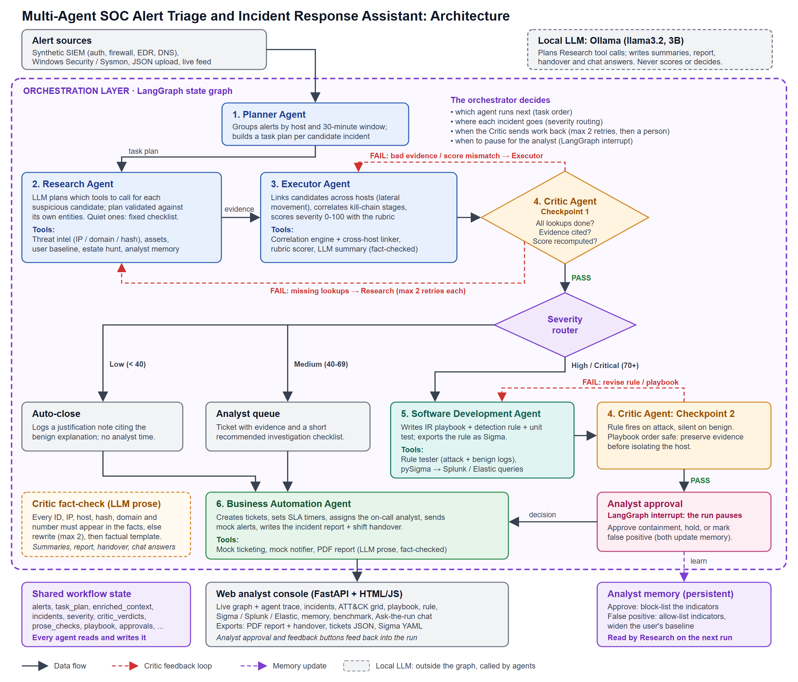

# Multi-Agent SOC Alert Triage and Incident Response Assistant

CA-3 Agentic AI Proof of Concept · Domain: Cybersecurity Operations · SIT Pune

A SOC receives more alerts than analysts can investigate by hand. Six cooperating agents, orchestrated
by a LangGraph state graph, turn raw alerts into prioritised incidents with a response playbook, a
tested detection rule (exported as Sigma), a ticket and a report. A Critic validates the work at every
step and sends failures back for correction; an analyst approves containment, and what analysts teach
the system is remembered for the next run.



## Agents

1. **Planner** groups alerts by host and time window into candidate incidents.
2. **Research** lets the LLM plan each suspicious investigation: which indicators to look up, which hosts
   and users to profile, which indicators to hunt across the estate. The plan is validated (known tools,
   arguments from the candidate only) before it runs.
3. **Executor** links candidates across hosts (lateral movement), correlates kill-chain stages, scores severity 0–100.
4. **Critic** checks that every lookup was done (else back to Research), that every claim cites real
   alerts and the score matches an independent recomputation (else back to the Executor), that the detection
   rule fires on attacks and stays silent on benign logs and the playbook preserves evidence first (else back
   to Software Development), and fact-checks every sentence the LLM writes (else the LLM rewrites it).
5. **Software Development** writes the playbook, a detection rule, its unit test, and the Sigma export
   (converted to Splunk and Elastic queries with pySigma).
6. **Business Automation** creates tickets, sets SLAs, sends mock notifications, writes the report and handover.

Severity routing: below 40 auto-close, 40 to 69 analyst queue, 70 and above playbook plus rule, then
analyst approval (approve, hold, or false positive).

## Run

Needs Python 3.11 (tested on 3.11.9) and [Ollama](https://ollama.com).

```
pip install -r requirements.txt
ollama pull llama3.2
python scripts/generate_data.py
python server.py          # web console at http://localhost:8000
```

The console uses a local [Ollama](https://ollama.com) model only (no paid API, no cloud). The LLM plans
investigations and writes prose; grouping, scoring, routing and every pass/fail decision are deterministic
Python. If Ollama fails mid-run, the run stops with an error rather than falling back to canned text.

Settings (environment variables, all optional): `OLLAMA_HOST` (default `localhost:11434`), `SOC_HOST` /
`SOC_PORT` for the console (default `127.0.0.1:8000`). The console has no login, so keep it on localhost.

## Console

- Live orchestration graph showing the path taken, including every Critic loop
- Live alert feed: alerts arrive in time order and candidate incidents form as you watch
- Fault injection: "Critic loops" (each checkpoint rejects once, then passes) or "Persistent" (retries exhausted → human)
- Datasets: synthetic SIEM alerts, a Windows Security + Sysmon sample, or upload your own JSON
- Incident detail: timeline, score breakdown, Critic verdicts, the LLM's investigation plan, analyst feedback buttons
- MITRE ATT&CK coverage grid, response playbook, detection rule, Sigma / Splunk / Elastic export
- Analyst memory: false positives allow-list indicators and widen user baselines; confirmed incidents block-list indicators
- Benchmark: many datasets and a Critic ablation, from the browser
- "Ask the run" chat: facts retrieved in Python, answer written by the LLM, fact-checked by the Critic
- Exports: PDF report + handover, tickets JSON, Sigma YAML

## Data

Everything is synthetic. `generate_data.py --seed N --alerts M` builds four attack chains hidden in benign
noise (brute force → admin account; phishing → malware → beaconing; off-hours exfiltration; credential
dumping → lateral movement to the domain controller), with hosts, users, indicators and timings varying per
seed. `data/samples/windows_sysmon_sample.json` uses Windows Security / Sysmon field names (as in the OTRF
Security-Datasets) and is parsed by `tools/ingest.py`. All integrations (threat intel, ticketing, notifications) are mocks.

## Evaluation

```
python eval/run_eval.py
```

Reports the demo dataset against `data/ground_truth.json`, then:

- **Benchmark**: 5 seeds × 150/300/600 alerts → precision, recall and F1 on attack alerts, chains detected,
  benign incidents escalated.
- **Ablation**: 42 random faults (7 types × 6, each on a random dataset and target), run with the Critic
  enforcing and with it disabled → caught, corrected, and shipped-without-Critic counts per fault type.

Tests (`pytest`) and the benchmark use a deterministic mock model, so they need neither Ollama nor a network.

## Limitations

Synthetic, scripted attacks; mock integrations; fixed correlation rules and rubric; the Windows sample is
small and hand-written in the public dataset format; a 3B local model writes the prose, so wording can be
awkward (the fact-check stops it from inventing IDs, IPs, hosts or numbers, not from being clumsy).

See `CLAUDE.md` for the build spec and design notes.
